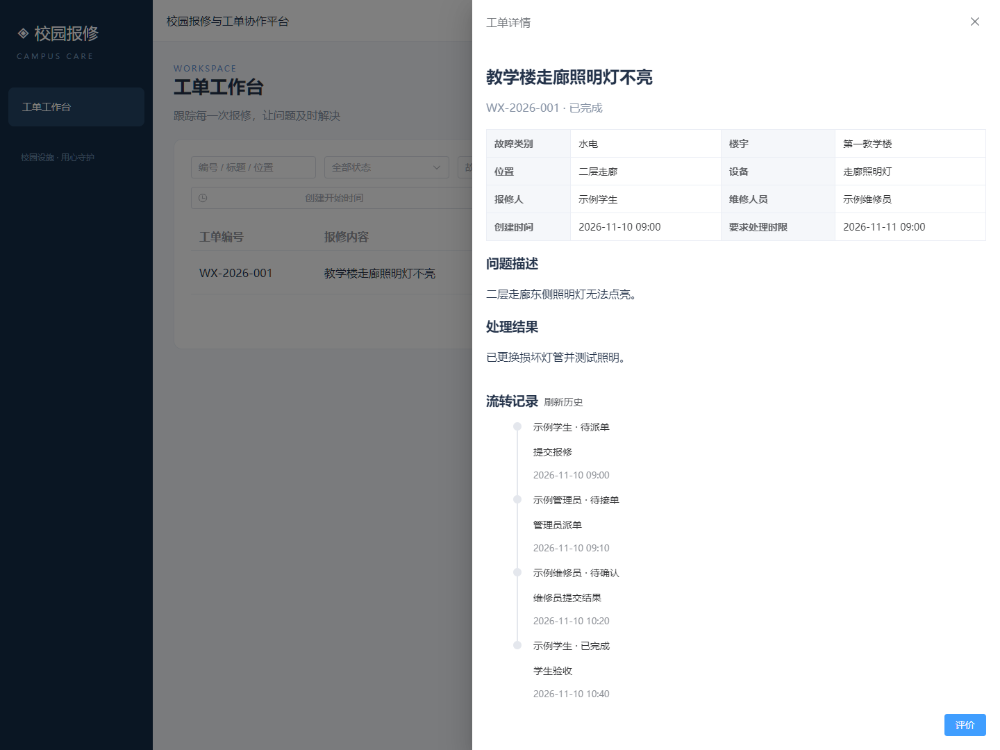

# 校园报修与工单协作平台

  

学生上报故障，管理员派单或转派，维修人员提交处理结果，学生验收或退回重修。每次状态变更都保留流转记录，三个角色可以在同一张工单上跟进进度。

个人项目。独立完成 Java 后端，前端使用 AI 辅助开发，并结合接口文档联调。

[本地启动](#本地启动) · [接口文档](docs/校园报修与工单协作平台-接口文档.md) · [数据库结构](src/main/resources/db/schema.sql) · [前端源码](frontend/src)



*工单详情页面预览，使用虚构的演示数据。*

## 后端实现

| 场景 | 实现 | 代码入口 |
| --- | --- | --- |
| 两名管理员先后操作同一张工单 | 按预期版本更新，过期派单返回 HTTP 409。事务内同时写入状态和流转记录。 | [工单服务](src/main/java/com/weixingyu/campusrepairticketsystem/service/impl/TacketAdminServiceImpl.java) · [回归用例](src/test/java/com/weixingyu/campusrepairticketsystem/CompletedInterfacesRegressionTest.java) |
| 维修员停用后仍有活跃会话 | Redis 通过用户 ID 维护 Token 集合，支持撤销该用户的全部会话。 | [会话管理](src/main/java/com/weixingyu/campusrepairticketsystem/cache/LoginSessionStore.java) |
| 多个请求同时读取未缓存的工单 | 按工单加 Redisson 锁，取得锁后再次检查缓存。工单变更在事务提交后清理详情缓存。 | [缓存实现](src/main/java/com/weixingyu/campusrepairticketsystem/cache/RedisCacheClient.java) · [缓存测试](src/test/java/com/weixingyu/campusrepairticketsystem/RedisCacheClientTest.java) |
| 学生验收时查看维修照片 | 报修和维修图片上传至阿里云 OSS，详情查询同时返回两类附件。 | [附件查询](src/main/resources/com/weixingyu/mapper/TicketsAdminMapper.xml) |

**技术栈**　Java 24、Spring Boot 4、MyBatis、MySQL、PageHelper、Redis、Redisson、阿里云 OSS。前端采用 Vue 3、Vue Router、Element Plus、Axios 和 Vite。

## 本地启动

准备 JDK 24、Maven 3.9、MySQL 8、Redis 和 Node.js。以下命令使用 PowerShell，从仓库根目录执行。

**1 · 初始化本地数据库。** 依次在 MySQL 客户端执行 [建表脚本](src/main/resources/db/schema.sql) 和 [演示数据](src/main/resources/db/data-dev.sql)，创建 campus_repair 数据库、基础数据和演示工单。

**2 · 启动后端。** 先启动 MySQL 和 Redis，再在当前终端设置连接信息。默认连接本机 MySQL 3306、Redis 6379（数据库 1）。

```powershell
$env:DB_USER = "root"
$env:DB_PASSWORD = "填写本机 MySQL 密码"
# Redis 启用密码认证时设置 REDIS_PASSWORD
mvn spring-boot:run
```

上传真实图片时配置 OSS_BUCKET、OSS_ENDPOINT、OSS_REGION、OSS_ACCESS_KEY_ID 和 OSS_ACCESS_KEY_SECRET，使用自有测试存储桶。完整配置见 [application.yaml](src/main/resources/application.yaml)。

**3 · 启动前端。** 新开一个终端。

```powershell
cd frontend
npm ci
npm run dev
```

打开 Vite 打印的本地地址。前端默认代理到 localhost:8080。用不同浏览器标签页分别登录 student001、admin001、repairer001，按报修、派单、维修、验收的顺序体验。演示密码见本地演示数据脚本开头。

## 验证

运行工单行为、缓存和请求参数三组测试：

```powershell
mvn "-Dtest=CompletedInterfacesRegressionTest,RedisCacheClientTest,RequestValidationMigrationTest" test
```

在 frontend 目录执行 `npm run build` 构建前端。数据库、Redis、真实 OSS 的端到端联调需要另外启动相应服务。
