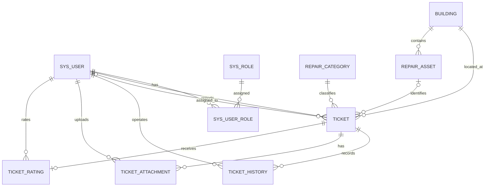

# 校园报修与工单协作平台数据库设计说明

## 1. 文档用途与脚本位置

数据库名：`campus_repair`。数据库脚本适用于 MySQL 8.0+，表使用 InnoDB，字符集为 `utf8mb4`。

- 项目实际初始化脚本：`src/main/resources/db/schema.sql`
- 项目本地开发种子数据：`src/main/resources/db/data-dev.sql`
- 本文档随附 SQL 备份：`docs/database/sql-backup/schema.sql`、`docs/database/sql-backup/data-dev.sql`

`src/main/resources/db/` 是项目运行和开发时应维护的权威版本。`docs/database/sql-backup/` 是本次整理时复制的备份快照；脚本变更后请同步更新备份，避免两个版本不一致。

## 2. 初始化顺序

1. 使用 MySQL 客户端执行 `schema.sql`，创建 `campus_repair` 数据库及业务表。
2. 再执行 `data-dev.sql`，插入本地角色、账号、楼宇、类别、设备和演示工单。
3. Spring Boot 连接地址中的数据库名应为 `campus_repair`。

`data-dev.sql` 仅供本地开发和演示。脚本中的账号密码为练习用途，生产环境不得使用或提交真实凭据。`INSERT IGNORE` 让部分基础数据可以重复导入，但不会更新已存在的数据。

## 3. 表清单与职责

| 表名 | 用途 | 主要关联 |
|---|---|---|
| `sys_user` | 登录账号、姓名、联系方式及启停状态 | 被工单、历史、附件、评价引用 |
| `sys_role` | 固定角色目录，角色编码如 `STUDENT`、`REPAIRER`、`ADMIN` | 通过 `sys_user_role` 关联用户 |
| `sys_user_role` | 用户与角色的关联表 | `user_id` → `sys_user.id`；`role_id` → `sys_role.id` |
| `building` | 校园楼宇基础数据 | 被设备和工单引用 |
| `repair_category` | 报修类别字典 | 被工单引用 |
| `repair_asset` | 楼宇内可选的维修设备/设施档案 | `building_id` → `building.id`；可被工单引用 |
| `ticket` | 报修工单主体，保存报修内容、状态、优先级、处理人和 SLA | 关联用户、类别、楼宇、可选设备 |
| `ticket_no_sequence` | 按日期原子分配工单编号序号 | 独立序列表，以日期为主键 |
| `ticket_history` | 每次工单状态/处理动作的审计历史 | 关联工单、操作人和前后处理人 |
| `ticket_attachment` | 工单报修图片或处理结果图片的元数据和路径 | 关联工单及上传用户 |
| `ticket_rating` | 报修人对已完成工单的一次评价 | 关联工单及报修人；每张工单最多一条 |

## 4. 表关系

- 用户与角色是多对多关系，通过 `sys_user_role` 拆分；`role_id` 是数据库内部关联 ID，接口应返回稳定的角色编码，而不是依赖数字 ID 表达角色含义。
- 工单有一个报修人、至多一个当前维修人；一个用户可以报修或处理多张工单。
- `ticket.asset_id` 可为空：设备没有登记时仍可按 `building_id + room` 报修。
- `ticket` 保留类别、楼宇、设备名称快照字段，避免基础资料改名后历史工单展示名称随之改变；这些快照是冗余但有业务目的的数据。
- `ticket_no_sequence` 不通过外键连工单。编号分配应和工单创建事务结合，避免并发下重复发号。
- `ticket_rating.ticket_id` 唯一，保证每张工单最多一条评价。

## 5. 重点字段和约束

### `sys_user`

- `username` 唯一；`password_hash` 保存 BCrypt 哈希，不保存明文密码。
- `enabled`：`1` 启用，`0` 停用。停用保留历史关联数据。

### `sys_role` / `sys_user_role`

- `role_code` 唯一，作为程序和接口识别角色的稳定编码。
- `sys_user_role` 复合主键 `(user_id, role_id)` 防止同一用户重复分配同一角色。

### `ticket`

- `ticket_no` 唯一；`status` 与 `priority` 通过 CHECK 约束限制合法值。
- `version` 用于状态变化并发控制；写操作应结合当前状态/版本做条件更新。
- `sla_due_at` 保存创建时确定的截止时间，便于稳定统计超时。
- 多列索引支持按报修人、处理人、状态、楼宇、类别及 SLA 查询列表。

### `ticket_history`

- 唯一键 `(ticket_id, event_version)` 防止同一工单版本重复写历史。
- 工单状态更新与历史插入应放在同一事务中，确保两者一起成功或一起回滚。

### 删除策略

外键采用 `ON DELETE RESTRICT`，防止误删用户、楼宇、类别、设备或工单后破坏历史记录。业务上优先停用基础数据，不做物理级联删除。

## 6. 索引设计概览

- `sys_user.username`、`sys_role.role_code`、`ticket.ticket_no` 使用唯一约束。
- 工单索引围绕常用筛选和排序组合：报修人+创建时间、处理人+状态+更新时间、状态+创建时间、楼宇/类别+创建时间、状态+SLA 时间。
- 历史索引支持工单时间线及操作人审计查询。
- 实际查询上线前仍应通过 `EXPLAIN` 检查执行计划；索引会增加写入与存储成本，不应无依据叠加。

## 7. 数据一致性与事务边界

以下操作应视为一个事务边界：

1. 创建工单、生成编号、插入初始 `ticket_history`。
2. 派单/转派/接单/拒绝/开始处理/提交结果/确认/重开/取消/关闭时，更新 `ticket` 并插入对应 `ticket_history`。
3. 提交评价时，校验工单状态、插入 `ticket_rating`，并保证唯一评价约束。

状态更新使用带状态或 `version` 条件的 SQL；若更新行数为 0，按状态冲突处理，不应继续写历史。

## 8. 设计范围说明

当前 MVP 为单校区关系型业务系统。工单列表、SLA 和统计由 MySQL 承担；当前无需为了技术栈展示而增加 Redis、消息队列或搜索引擎。附件表保存文件元数据和访问路径，文件本体不存入 MySQL。
